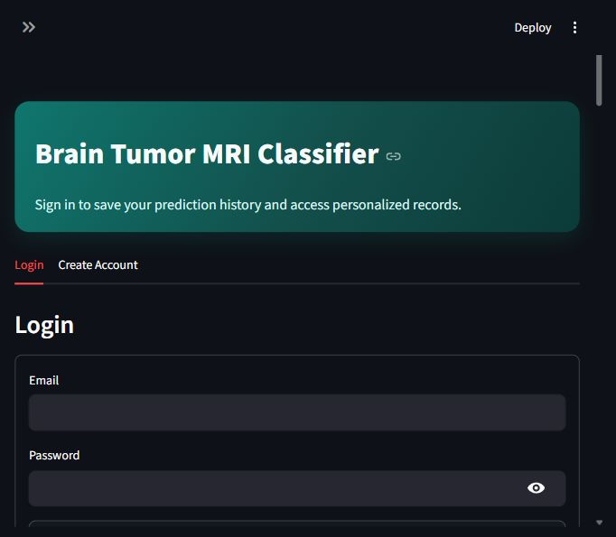
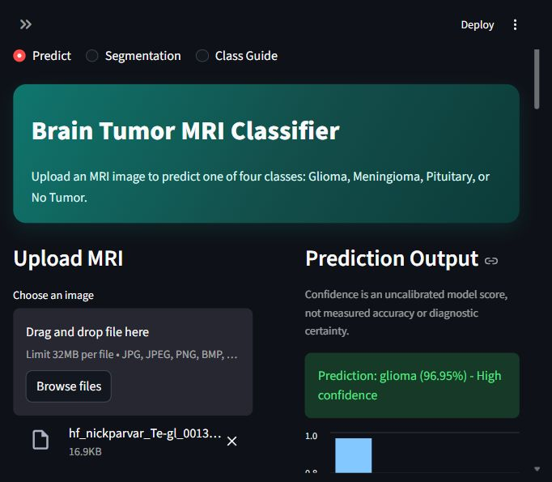
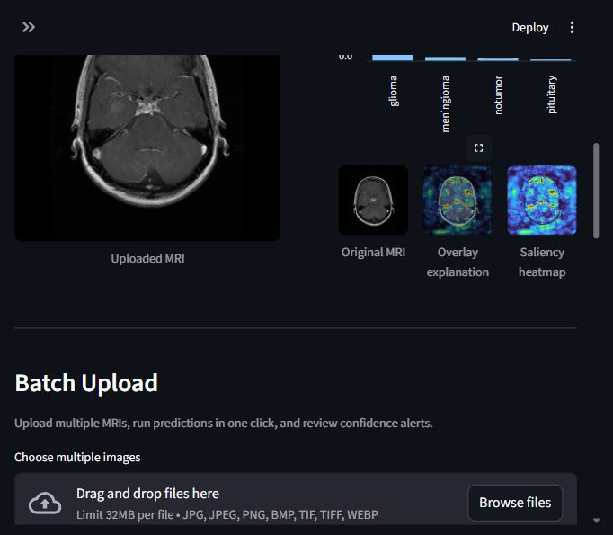
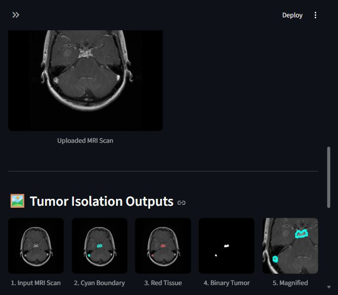
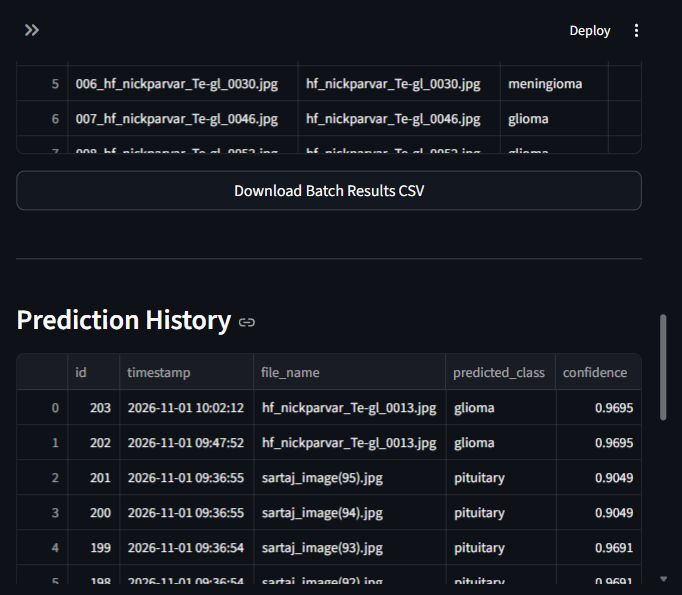
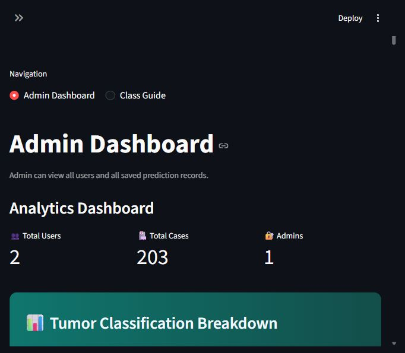

# Brain Tumor Classification

End-to-end brain MRI tumor classification project with:

- Streamlit application with authentication, prediction, batch upload, heatmaps, and admin dashboard.
- Training and tuning notebooks (Optuna-based hyperparameter search).
- Inference notebook for standalone model prediction workflows.
- Dataset organized as ImageFolder-compatible train/test directories.

This project is intended for educational and research use only.

## Live Demo

[Open the Streamlit Community Cloud app](https://braintumourprediction-5ntt4vba5gqhwwwxyywxqu.streamlit.app/)

[GitHub repository](https://github.com/BharathLingaReddy-Palem/Brain_Tumour_Prediction) · deployment branch: `main` · entry point: `app.py` · Python: `3.11`.

## Project Structure

```text
Brain_Tumor_Classification/
|- app.py
|- requirements.txt
|- README.md
|- brain_tumor_app.db
|- Dataset/
|  |- Training/
|  |  |- glioma/
|  |  |- meningioma/
|  |  |- pituitary/
|  |  |- notumor/
|  |- Testing/
|     |- glioma/
|     |- meningioma/
|     |- pituitary/
|     |- notumor/
|- artifacts/
|  |- best_brain_tumor_model.pth
|  |- best_tuned_model_state.pth
|  |- class_mapping.json
|  |- optuna_trials_summary (1).csv
|  |- model_comparison_metrics.csv
|  |- batch_predictions.csv
|- brain_tumor_inference.ipynb
|- hyperparameter_tuning_brain_tumor (4).ipynb
|- brain_tumor_cnn_step1_2 (1).ipynb
|- assets/
|  |- examples/
|- uploaded_scans/
```

## What The App Includes

The Streamlit app in `app.py` currently supports:

- User signup/login with PBKDF2 password hashing.
- Role-based access (`user`, `admin`) with database-backed persistence.
- Single-image prediction with confidence scoring and class probability chart.
- Batch prediction for multiple images with CSV export.
- Saliency heatmap visualization (SmoothGrad-style overlay).
- Saved prediction history with deletion and CSV download.
- Admin analytics dashboard:
  - user counts,
  - class distribution,
  - confidence trends,
  - global prediction record filtering/deletion,
  - image viewer and image downloads.
- Account management:
  - user self-delete with password confirmation,
  - admin credential updates,
  - admin-managed user updates/deletions.

## Current Application Screenshots

Captured from the repaired application on 1 November 2026, using a separate demonstration database and public MRI test images. The existing `assets/report/` folder contains these screenshots; older report figures remain available alongside them.

### Sign-in



### MRI classification and probabilities



### SmoothGrad visual explanation



### Graph-cut segmentation



### Batch prediction results



### Admin analytics



The displayed model confidence is an uncalibrated score, and segmented regions are experimental candidates. Screenshots do not establish diagnostic accuracy. MRI example attribution: [Simezu mirror](https://huggingface.co/datasets/Simezu/brain-tumour-MRI-scan) of [Masoud Nickparvar's Brain Tumor MRI Dataset](https://www.kaggle.com/datasets/masoudnickparvar/brain-tumor-mri-dataset); source revisions and image hashes are recorded in [the test manifest](webtesting_folder/manifest.json).

## Model Artifacts and Their Purpose

There are two model checkpoints in `artifacts/`:

1. `best_tuned_model_state.pth`
   - Training/tuning artifact.
   - Useful for experimentation and reproducibility.
   - May include tuning metadata (best params, class names, etc.).

2. `best_brain_tumor_model.pth`
   - Deployment artifact used by the Streamlit app.
   - Contains app-expected fields such as `model_name`, `state_dict`, `idx_to_class`, and `img_size`.

Important:

- The app loads `artifacts/best_brain_tumor_model.pth`.
- Re-exporting tuned weights into this file changes format/packaging, not model quality.
- Recent verification showed both checkpoints produce the same test metrics in this workspace.

## Verified Evaluation — 1 November 2026

Using the unchanged deployed checkpoint in the `computer_vision` conda environment:

| Evaluation | Images | Accuracy | Macro F1 |
|---|---:|---:|---:|
| Original local Testing split | 1,600 | 94.00% | 0.9384 |
| Unique local tests excluding exact training overlap | 1,468 | 94.55% | 0.9425 |
| Downloaded web MRI images | 200 | 88.00% | 0.8726 |

All 200 images were also uploaded through the running browser; its exported predictions matched offline evaluation exactly. **193 downloads match local dataset images**, and the local test split contains 114 files matching training images. These numbers are dataset measurements, not independent clinical accuracy. The six unique web images without exact local matches scored 4/6, which is insufficient for an external accuracy estimate.

See [PROJECT_AUDIT.md](PROJECT_AUDIT.md) for fixes, class-level weaknesses, test scope, remaining issues, and suggested features. See [webtesting_folder/README.md](webtesting_folder/README.md) for sources, provenance, CSVs, screenshots, and reproduction commands.

```powershell
$python = 'C:\Users\acer\anaconda3\envs\computer_vision\python.exe'
& $python -m unittest discover -s tests -v
& $python scripts\smoke_notebooks.py
& $python scripts\evaluate_model.py
& $python -m streamlit run app.py
```

No retraining is required to run the repaired app. New bootstrap admins require `ADMIN_PASSWORD` to be set; existing accounts are preserved.

## Historical Model Comparison Results

Using saved results from:

- `artifacts/model_comparison_metrics.csv`
- `artifacts/optuna_trials_summary (1).csv`

Best-performing model overall for classification accuracy and macro-F1 is **Basic CNN**.

### Test Set Metrics (`model_comparison_metrics.csv`)

- Basic CNN: test accuracy `0.9256`, test macro-F1 `0.9244`
- EfficientNet-B0: test accuracy `0.8363`, test macro-F1 `0.8333`
- ResNet50: test accuracy `0.8313`, test macro-F1 `0.8260`

### Optuna Validation Summary (`optuna_trials_summary (1).csv`)

- BasicCNN: best val macro-F1 `0.9626`, mean val macro-F1 `0.9341`
- EfficientNet-B0: best val macro-F1 `0.8993`, mean val macro-F1 `0.7958`
- ResNet50: best val macro-F1 `0.8904`, mean val macro-F1 `0.7139`

## Environment Setup

### 1) Install dependencies

```bash
pip install -r requirements.txt
```

For training, Optuna, notebooks, evaluation, or the audit tools:

```bash
pip install -r requirements-dev.txt
```

The existing `computer_vision` conda environment can be used directly. The cloud requirements use CPU-only PyTorch and headless OpenCV; they do not require a GPU or desktop graphics libraries.

### 2) Run the app

```bash
streamlit run app.py
```

## Streamlit Community Cloud Deployment

The existing app is connected to `BharathLingaReddy-Palem/Brain_Tumour_Prediction`, branch `main`, main file `app.py`, Python `3.11`. Changes pushed to this branch are picked up by Community Cloud. Keep all modules (`inference.py`, `image_io.py`, and `segmentation/`) and the existing model/class-mapping artifacts in the repository.

1. Sign in at [Streamlit Community Cloud](https://share.streamlit.io/) and select the existing MRI app.
2. Keep the existing repository, branch, entry point, and app URL.
3. Install the root `requirements.txt`; training-only tools are in `requirements-dev.txt`.
4. Configure optional credentials in **App settings → Secrets**, using [.streamlit/secrets.toml.example](.streamlit/secrets.toml.example) as a reference. Never commit real secrets.
5. After the GitHub update, review the app logs and verify model loading and a sample upload. Use **Reboot** if the existing app needs a restart.

`.streamlit/config.toml` sets a 32 MB upload limit and disables usage-stat collection. Linux/Python 3.11 dependency resolution and the 24 local regression tests passed before this update was published.

SQLite and uploads on Community Cloud are local to the app instance and should not be treated as durable storage. Use an external database via `DATABASE_URL` and persistent image storage for records that must survive a rebuild. The publication update excludes the modified local account database, local uploads, and raw downloaded test images.

## Database and Auth Configuration

By default, the app uses local SQLite:

- `sqlite:///brain_tumor_app.db`

You can configure with environment variables:

- `DATABASE_URL` (for Postgres/other SQLAlchemy-compatible DB)
- `ADMIN_EMAIL` (default: `admin@brain.local`)
- `ADMIN_PASSWORD` (required to create a bootstrap admin in a new database; no default password)
- `ADMIN_NAME` (default: `System Admin`)
- `UPLOADS_DIR` (optional upload directory override; useful for isolated tests)

The default SQLite file lives in the project directory, regardless of the working directory. Setting `ADMIN_PASSWORD` does not change an existing administrator's password; use account management to rotate existing credentials.

If using Postgres, `postgres://` is auto-normalized to `postgresql://` in the app.

## Notebook Workflows

### `hyperparameter_tuning_brain_tumor (4).ipynb`

- Runs Optuna hyperparameter tuning.
- Retrains best config.
- Evaluates on test set.
- Exports artifacts for app compatibility.

Use this notebook when you want to improve or retune model settings.

### `brain_tumor_inference.ipynb`

- Loads deployed artifact.
- Performs single and batch inference.
- Exports batch prediction CSV.

Use this notebook for model sanity checks and offline prediction tasks.

## Re-Export Tuned Model for App

If you tune in notebook and want app to use latest tuned weights:

1. Open `hyperparameter_tuning_brain_tumor (4).ipynb`.
2. Run the export cell that writes:
   - `artifacts/best_brain_tumor_model.pth`
   - `artifacts/class_mapping.json`
3. Restart or rerun Streamlit app.

## Common Issues

### Missing variables in notebook export cell

If kernel was restarted and notebook variables are gone, the export flow can load from saved tuned artifacts (if present) and still generate app-compatible output.

### Streamlit model load error

Check these files exist:

- `artifacts/best_brain_tumor_model.pth`
- `artifacts/class_mapping.json`

### Notebook and app show different behavior

Ensure both are using the same deployed checkpoint (`best_brain_tumor_model.pth`) and same class mapping.

## Requirements

The deployment dependency versions are defined in [requirements.txt](requirements.txt), including Streamlit 1.55.0, CPU PyTorch 2.12.0/torchvision 0.27.0, pandas 2.3.3, scikit-image 0.26.0, and headless OpenCV 4.11.0.86. Python 3.11 is the configured Community Cloud runtime. Additional training and analysis dependencies are in [requirements-dev.txt](requirements-dev.txt).


## Disclaimer

This project is not a medical diagnosis system.
All predictions should be reviewed by qualified medical professionals.

